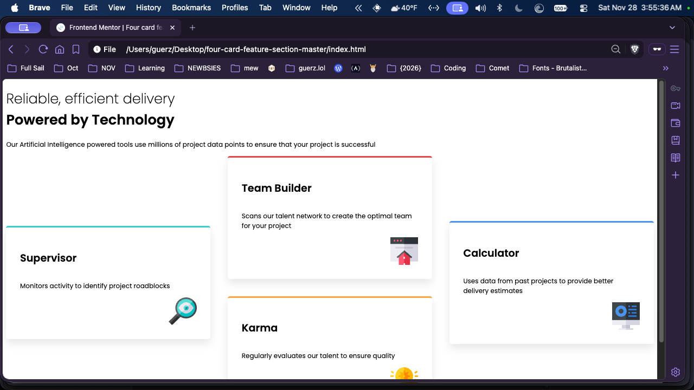
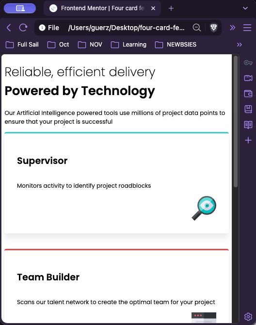

# Frontend Mentor - Four card feature section solution

This is a solution to the [Four card feature section challenge on Frontend Mentor](https://www.frontendmentor.io/challenges/four-card-feature-section-weK1eFYK). Frontend Mentor challenges help you improve your coding skills by building realistic projects.

## Table of contents

- [Overview](#overview)
  - [The challenge](#the-challenge)
  - [Screenshot](#screenshot)
- [My process](#my-process)
  - [Built with](#built-with)
  - [What I learned](#what-i-learned)
  - [Continued development](#continued-development)
  - [AI Collaboration](#ai-collaboration)
- [Author](#author)

## Overview

### The challenge

Users should be able to:

- View the optimal layout for the site depending on their device's screen size

### Screenshot

Desktop layout at a wide window:



Mobile layout, one column:



## My process

### Built with

- Semantic HTML5 markup
- CSS Grid for the desktop layout
- Flexbox inside each card
- Mobile-first workflow
- [Poppins](https://fonts.google.com/specimen/Poppins) from Google Fonts, weights 200, 400 and 600

### What I learned

The desktop design stacks Team Builder on top of Karma in the middle column, with Supervisor and Calculator centered on either side. Flex-wrap can't put two cards in one column next to taller side cards, so I wrapped the four cards in a `div` with the class `cards` and used CSS Grid.

The part that took longest was grid lines. `grid-row: 1 / 3` starts at line 1 and ends at line 3, so two rows have three lines. The side cards span both rows and use `align-self: center`, so they sit in the middle instead of stretching to full height.

Mobile is the base: one column. The three-column grid and the card placements only turn on at 48rem and up, inside a media query.

```css
@media (min-width: 48rem) { /* everything below only applies at 48rem and wider */
    .cards {
        grid-template-columns: 1fr 1fr 1fr; /* three equal columns for the cards */
    }

    .blue {
        grid-column: 3; /* moves the blue card to the third column */
        grid-row: 1 / 3; /* starts at the first line and ends at line 3, so it covers both rows */
        align-self: center; /* vertically centers the blue card in its grid area */
    }
}
```

A few smaller things I picked up:

- `font-weight` takes no unit, so it's `200`, not `200px`.
- The heading is one `h1` with a `span` inside. `display: block` on the span puts "Powered by Technology" on its own line.
- The icons use an empty `alt=""` because the `h2` next to each one already names the card.
- `gap` goes on the parent of whatever you're spacing.

Most of my bugs were typos. A missing `>` on the `.cards` div and a missing slash on `</h1>` broke the whole layout, and an unsaved file cost me a confusing stretch of "nothing changes".

### Continued development

- Catching missing characters (`>`, `/`, the dot in a class selector) faster, using the editor's colors and DevTools.
- Measuring spacing, corner radius and the card gap against the design file instead of judging by eye.
- Choosing a breakpoint from the content. I used 48rem as a starting point.

### AI Collaboration

I used Claude as a mentor and wrote the HTML and CSS myself. It gave hints in steps, explained new terms with made-up examples, and pointed to the exact line when I made a typo, like the missing `>` and the missing slash. Small, concrete questions worked best. Open questions like "which element would you wrap these in?" confused me twice.

One exception: near the end I was worn out and asked Claude to put my existing rules into one block. It rebuilt the media query from lines I had already written.

## Author

- Website - [guerz.lol](https://guerz.lol)
- Frontend Mentor - [@gitguerz](https://www.frontendmentor.io/profile/gitguerz)
